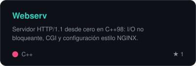
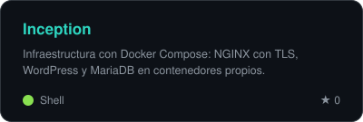
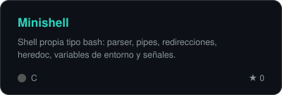
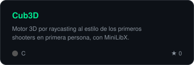
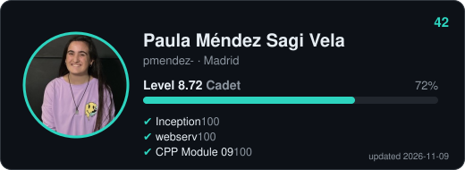
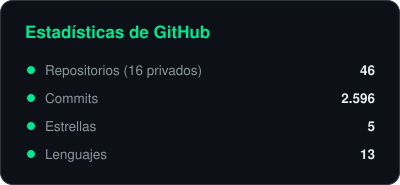
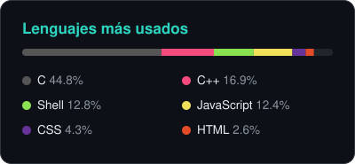

  
  
  
  

---

## 👩‍💻 Sobre mí

Soy **Ingeniera de Software con especialización en Ciberseguridad** y estudiante en **42 Telefónica**, donde aprendo programando proyectos reales desde cero, sin clases ni profesores, revisando código con otros estudiantes.

- 🔐 Me interesa la **ciberseguridad**, los **sistemas** y entender cómo funcionan las cosas por dentro.
- 🛠️ He escrito en **C y C++** una shell, un servidor HTTP y un motor de raycasting, entre otros.
- 🐳 Monto infraestructura con **Docker**, NGINX y redes Linux.
- 🌱 Ahora mismo: terminando el *common core* de 42 y profundizando en seguridad ofensiva y defensiva.
- 🤝 **Abierta a oportunidades** en desarrollo, sistemas o ciberseguridad. ¡Escríbeme!

---

## 🧰 Tecnologías

**Lenguajes**

**Herramientas e infraestructura**

---

## ⭐ Proyectos destacados

| Proyecto | Qué es | Stack |
|---|---|---|
| 🌐 [**Webserv**](https://github.com/pauss12/42_WEBSERVER) | Servidor HTTP/1.1 desde cero con I/O no bloqueante, CGI y ficheros de configuración estilo NGINX. | `C++98` `Sockets` `HTTP` |
| 🐳 [**Inception**](https://github.com/pauss12/Inception) | Infraestructura con Docker Compose: NGINX con TLS, WordPress y MariaDB, cada uno en su propio contenedor. | `Docker` `NGINX` `TLS` |
| 🐚 [**Minishell**](https://github.com/pauss12/Minishell) | Mi propia shell tipo bash: parser, pipes, redirecciones, heredoc, variables de entorno y señales. | `C` `Procesos` `Unix` |
| 🎮 [**Cub3D**](https://github.com/pauss12/CUB3D) | Motor 3D por raycasting al estilo de los primeros shooters en primera persona. | `C` `MiniLibX` `Matemáticas` |
| 🍝 [**Philosophers**](https://github.com/pauss12/42_PHILOSOPHERS) | El clásico problema de concurrencia resuelto con threads y mutex, sin data races ni deadlocks. | `C` `pthreads` |
| 🧩 [**C++ Modules**](https://github.com/pauss12/42_CPP) | Recorrido completo por C++: POO, herencia, polimorfismo, excepciones, templates y STL. | `C++` |
| 🌐 [**NetPractice**](https://github.com/pauss12/NetPractice) | Configuración de redes: direccionamiento IP, máscaras, subnetting y enrutamiento. | `Redes` `TCP/IP` |
| 🔐 [**Piscine Cyber**](https://github.com/pauss12/42_PISCINE_DISCOVERY_CYBER) | Iniciación a la ciberseguridad en la piscina *Discovery* de 42. | `Shell` `Seguridad` |

<b>📚 Todo el camino en 42</b>

 

| Círculo | Proyectos |
|---|---|
| 0 | [Libft](https://github.com/pauss12/42_LIBFT) |
| 1 | [ft_printf](https://github.com/pauss12/42_PRINTF) · [get_next_line](https://github.com/pauss12/42_GET_NEXT_LINE) |
| 2 | [push_swap](https://github.com/pauss12/42_PUSH_SWAP) · [pipex](https://github.com/pauss12/42_PIPEX) · [so_long](https://github.com/pauss12/42_SO_LONG) |
| 3 | [Minishell](https://github.com/pauss12/Minishell) · [Philosophers](https://github.com/pauss12/42_PHILOSOPHERS) |
| 4 | [Cub3D](https://github.com/pauss12/CUB3D) · [NetPractice](https://github.com/pauss12/NetPractice) · [CPP Modules](https://github.com/pauss12/42_CPP) |
| 5 | [Webserv](https://github.com/pauss12/42_WEBSERVER) · [Inception](https://github.com/pauss12/Inception) |
| Exámenes | [Rank 02](https://github.com/pauss12/42_EXAM_RANK_02) · [Rank 03](https://github.com/pauss12/42_EXAM_RANK_03) · [Rank 04](https://github.com/pauss12/EXAM_RANK04) |
| Piscinas | [Piscina C](https://github.com/pauss12/42Telefonica) · [Discovery Cyber](https://github.com/pauss12/42_PISCINE_DISCOVERY_CYBER) |

<b>🎓 Proyectos de la universidad y otros</b>

 

| Proyecto | Tema | Stack |
|---|---|---|
| [Android_Studio](https://github.com/pauss12/Android_Studio) · [Practica_Calculadora](https://github.com/pauss12/Practica_Calculadora) | Apps Android | `Kotlin` |
| [Web_Servidor](https://github.com/pauss12/Web_Servidor) | Desarrollo web en servidor | `JavaScript` `Node.js` |
| [Utad_Web](https://github.com/pauss12/Utad_Web) | Desarrollo web | `HTML` `CSS` |
| [Practica_Sistemas_Distribuidos](https://github.com/pauss12/Practica_Sistemas_Distribuidos) | Sistemas distribuidos | `C++` |
| [Practica1](https://github.com/pauss12/Practica1_SistemasOperativos) · [Practica2](https://github.com/pauss12/Practica2_SistemasOperativos) | Sistemas operativos | `C` |
| [Paradigmas_Programacion](https://github.com/pauss12/Paradigmas_Programacion) | Paradigmas de programación | `Python` |
| [Ejercicios-Algoritmos](https://github.com/pauss12/Ejercicios-Algoritmos) | Algoritmia | `C++` |
| [Club_Deportivo](https://github.com/pauss12/Club_Deportivo) | Gestión de un club | `C` |

---

## 🆕 Últimos proyectos

Esta lista se actualiza sola cada día con lo último que he subido.

<!-- PROJECTS:START -->
| Proyecto | Descripción | Lenguaje | Actualizado |
|---|---|---|---|
| [**Inception**](https://github.com/pauss12/Inception) | Infraestructura con Docker Compose: NGINX + TLS, WordPress y MariaDB en contenedores propios. | `Shell` | 2026-11-06 |
| [**42_WEBSERVER**](https://github.com/pauss12/42_WEBSERVER) | Servidor HTTP/1.1 en C++98 con I/O no bloqueante, CGI y configuración estilo NGINX. | `C++` | 2026-10-17 |
| [**42_CPP**](https://github.com/pauss12/42_CPP) | Todos los ejercicios que he ido realizando en la piscina CPP | `C++` | 2026-09-08 |
| [**42_PHILOSOPHERS**](https://github.com/pauss12/42_PHILOSOPHERS) | El problema de los filósofos con threads, mutex y sincronización. | `C` | 2026-07-16 |
| [**NetPractice**](https://github.com/pauss12/NetPractice) | Ejercicios de redes: direccionamiento IP, subnetting y tablas de enrutamiento. | `—` | 2026-02-01 |
| [**CUB3D**](https://github.com/pauss12/CUB3D) | Motor de raycasting 3D al estilo de los primeros shooters, en C con MiniLibX. | `C` | 2025-12-15 |
<!-- PROJECTS:END -->

---

## 📊 Estadísticas

  

---

## 📫 Hablemos

¿Tienes un proyecto, una oferta o simplemente quieres hablar de código o ciberseguridad?

